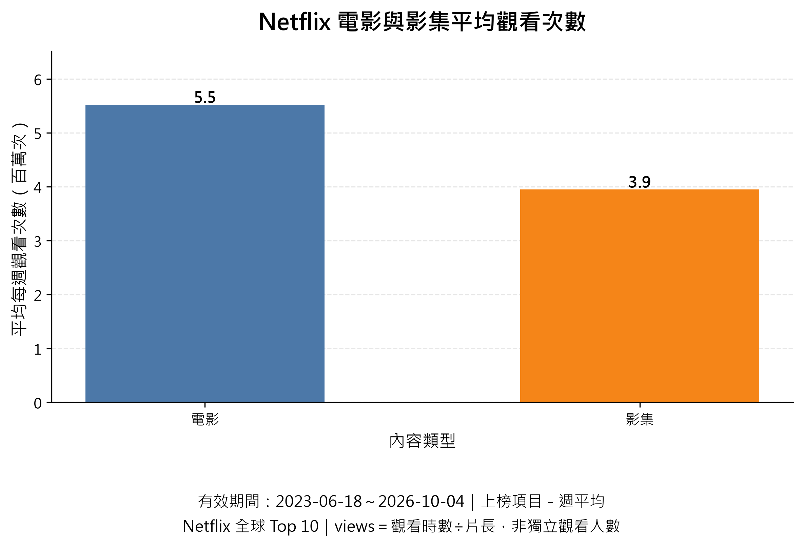
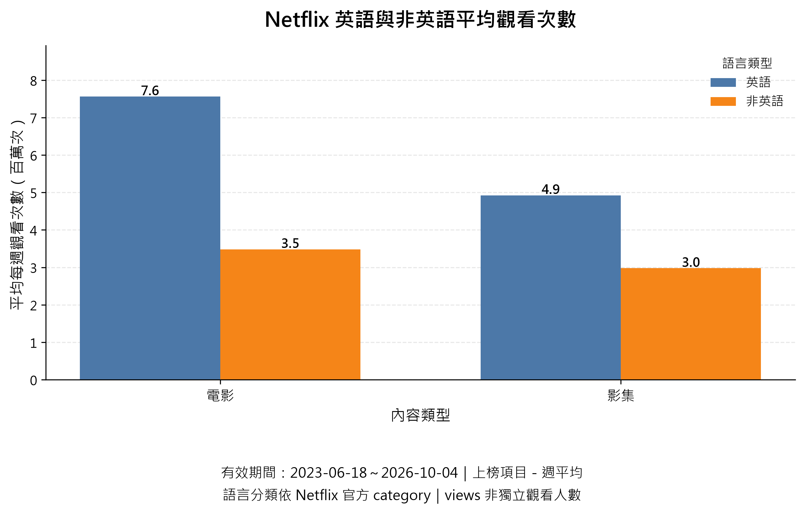
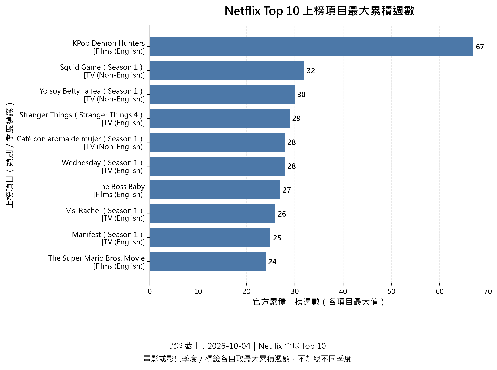
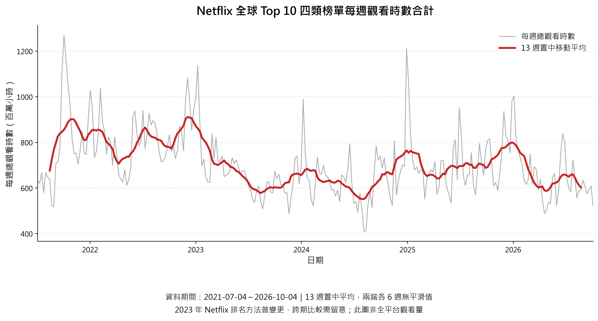
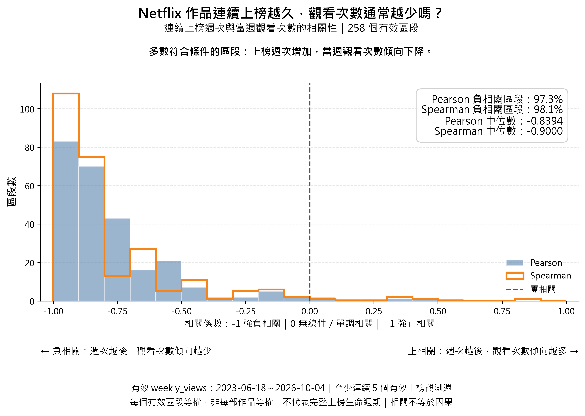

# Netflix 全球 Top 10：研究方法、結果與限制

本報告整理 Python 資料分析專題的五個研究問題，使用 2026-10-20 下載並固定保存的 Netflix 官方資料。正式資料截止週為 **2026-10-04**，清洗後共 **11,000 筆**。

數據採用專案階段 2～4 已完成的正式驗證紀錄；本次文件整理沒有重新下載或重新分析資料。圖表引用已驗收版本，圖 01～04 採第一輪修訂，圖 05 採第二輪修訂。

這是新固定快照的研究結果，**不是 2026/08 舊版分析的重新重現**。README.md 已整理為求職作品集首頁，本報告保留完整研究方法、正式數值與研究限制；本報告中的基準與目前正式圖表一致。

## 1. 研究目的與問題

本專題以 Python 建立「下載 → 清洗與驗證 → 分析 → 繪圖」流程，觀察 Netflix 全球 Top 10 上榜內容的觀看表現。單一熱門指標無法同時描述觀看次數、觀看時數與持續上榜情況，因此提出五個互補問題。

| 題目 | 研究問題 | 操作定義 |
|---|---|---|
| 第一題 | 電影與影集的熱門程度是否有差異？ | 比較兩類上榜項目－週的平均 `weekly_views` |
| 第二題 | 英語與非英語內容的觀看表現有何不同？ | 在 Films／TV 內，依官方語言類別比較項目－週平均 |
| 第三題 | 哪些項目在 Top 10 累積上榜最久？ | 電影或影集季度／標籤各自取官方累積週數最大值 |
| 第四題 | 熱門內容是否呈現時間趨勢？ | 加總全球四類榜單每週時數，觀察極值、年度週均及中期趨勢 |
| 第五題 | 連續上榜越久，當週觀看次數通常越少嗎？ | 在符合條件的連續有效 views 觀測區段內計算相關性，再等區段摘要 |

第三題保留原先「停留最久」的研究動機，但統計單位是官方公開上榜項目，不將整部影集所有季度視為一筆。第五題探討描述性相關，研究對象也不是完整上榜生命週期或 Netflix 全平台作品。

## 2. 資料來源與固定快照

### 2.1 來源與時間

來源為 [Netflix 官方全球 Top 10 歷史 Excel](https://www.netflix.com/tudum/top10/data/all-weeks-global.xlsx)。這是持續更新的下載端點，不是保證永遠回傳相同內容的版本網址。

| 項目 | 正式基準 |
|---|---|
| 下載日期 | 2026-10-20 |
| 下載開始（Asia/Taipei） | 2026-10-20 17:59:16.659825 +08:00 |
| 下載完成（Asia/Taipei） | 2026-10-20 17:59:19.341811 +08:00 |
| 資料最早／最晚週 | 2021-07-04／2026-10-04 |
| 工作表 | `Top 10` |
| 原始／清洗後筆數 | 11,000／11,000 |
| 不同週數 | 275，期間內無缺週 |
| 有效 `weekly_views` 期間 | 2023-06-18～2026-10-04 |
| 有效 `weekly_views` 筆數 | 6,920 |

**下載日期不等於資料截止週。** 雖於 10 月 20 日取得檔案，本快照最新只到 10 月 4 日；未確認原因，也不宣稱包含下載日前所有應公布週次。

四個官方 category 各有 2,750 筆：`Films (English)`、`Films (Non-English)`、`TV (English)`、`TV (Non-English)`。本快照每週 40 筆、每類 10 筆，沒有缺類或不完整排名。

### 2.2 檔案識別

| 產物 | 專案根目錄下的路徑 | 大小（bytes） |
|---|---|---:|
| 原始 Excel | `data/raw/netflix_top10_2026-10-20.xlsx` | 449,679 |
| 清洗 CSV | `data/processed/netflix_top10_clean.csv` | 986,361 |

原始 Excel SHA-256：

```text
e459bd06ca96a307917dc66f932176d1647c920917c630119d0d283dca7a5bea
```

清洗 CSV SHA-256：

```text
900d624a972b0e1d3fedce7b8fac044c5d42b243a9dff59c5a82d2da6d6cd34b
```

CSV 使用 `utf-8-sig` 編碼。正式驗證已確認 CSV 讀回與記憶體清洗結果一致，文字逐值相符，數值僅容許合理的浮點表示差異。

Excel 與 CSV 均由 Git 忽略，**不隨 GitHub Clone 提供**。雜湊用來確認已持有的檔案是否相同，不能據此重新取得原檔；具體重現條件見第 11 節。

## 3. 資料欄位與清洗

### 3.1 九個必要欄位

下表型態為本快照清洗／CSV 讀回後的觀察，日期精度可能依 Pandas 版本不同；排名等欄位另有整數值驗證。

| 欄位 | 型態 | 單位與意義 |
|---|---|---|
| `week` | datetime | 該筆週榜所屬日期；本快照皆為週日 |
| `category` | 字串 | 官方英語／非英語 Films／TV 四類 |
| `weekly_rank` | int64 | 該類別當週排名，1～10 |
| `show_title` | 字串 | 官方作品名稱，不保證是唯一識別碼 |
| `season_title` | 字串 | 官方季度或其他標籤；缺值填入 `Not specified` |
| `weekly_hours_viewed` | int64 | 該項目當週觀看時數，小時 |
| `runtime` | float64 | 官方片長，小時；TV 可能隨觀測週改變 |
| `weekly_views` | float64 | 官方當週觀看次數指標，次 |
| `cumulative_weeks_in_top_10` | int64 | 官方累積上榜週數，週；不等於目前連續區段週次 |

Netflix 的 views 定義為觀看時數除以片長，因此**不是獨立觀看人數**。本專題沿用官方 `weekly_views`，不依清洗後片長自行回算或填補。定義與排名變更參考 [Netflix 官方方法說明的 2023 更新](https://about.netflix.com/en/news/top-10-things-about-netflix-top-10)。

### 3.2 清洗與驗證流程

實作位於 [clean_data.py](../scripts/clean_data.py) 的 `clean_netflix_data()`；處理原始資料副本，不原地修改傳入 DataFrame。

1. 確認九欄完整且 DataFrame 不為空，移除內容完全相同的重複列。
2. 轉換日期及五個數值欄位，將缺少的 `season_title` 填入 `Not specified`。
3. 驗證關鍵值、官方類別、數值範圍、有限性與整數條件。
4. 檢查排名及上榜項目衝突；存在不合理資料時以 `ValueError` 回報欄位、筆數或衝突群組。
5. 將有限的 `runtime <= 0` 轉為缺失；保留同列仍有效的其他欄位。
6. 由 `save_cleaned_data()` 輸出 CSV，再由 `load_data()` 讀回分析。

驗證條件如下：

| 檢查 | 規則 |
|---|---|
| 關鍵欄位 | week、category、weekly_rank、show_title、weekly_hours_viewed、cumulative_weeks_in_top_10 不可缺失；類別／名稱空白字串亦拒絕 |
| 日期 | 必須可解析，無效日期不靜默保留 |
| category | 僅限四個官方類別 |
| 排名 | 1～10 的整數值 |
| 累積週數 | 大於等於 1 的整數值 |
| 觀看時數／有效 views | 有限且非負；合法零觀看不等於缺值 |
| 五個數值欄位 | 非空內容轉換失敗、正負無限值均拒絕，包含 runtime |
| 排名衝突 | 同 week、category、weekly_rank 不可有不同紀錄 |
| 項目衝突 | 同 week、category、show_title、season_title 不可重複出現 |

移除完全重複列與把非正片長轉缺失是明確的清洗規則；其他不合理輸入不會靠刪列、填零或推測季度來修復。不同季度同週上榜、跨 category 同名、TV 缺季或 Films 帶有 season_title 都可以是合法資料。

### 3.3 本快照品質與缺失值

| 欄位／檢查 | 原始資料 | 清洗後 |
|---|---:|---:|
| 資料筆數 | 11,000 | 11,000 |
| season_title 缺失 | 5,666 | 0（以占位字串保留未標示意義） |
| runtime 缺失 | 4,080 | 4,251 |
| weekly_views 缺失 | 4,080 | 4,080 |
| runtime=0 | 171 | 0（轉為缺失） |
| 完全重複額外列 | 0 | 0 |
| 同週同類別排名衝突群組 | 0 | 0 |
| 同週同類別作品及季度重複群組 | 0 | 0 |

其餘必要欄位原始缺值皆為 0。171 筆零片長全在 TV：英語 14 筆、非英語 157 筆。TV 原始缺季度 175 筆，不可自動補為 Season 1；Films 另有 9 筆帶季度／標籤，分類仍維持官方值。

4,080 筆 views 缺值全部在 2023-06-18 以前，最後缺值週為 2023-06-11；之後 6,920 筆均有值。歷史缺少 views 或 runtime **不代表零觀看，也不代表榜單不完整**。

## 4. 第一題：電影與影集平均每週觀看次數

### 4.1 問題與方法

電影與影集在 Top 10 的觀看表現是否不同？`analyze_content_type()` 先排除缺少 views 的列，依官方 category 建立 Films／TV，再對各組 `weekly_views` 取算術平均。

每一筆是「**上榜項目－週**」：同一項目上榜十週會貢獻十筆，不是每個唯一作品平均一次，也不是先計算每部作品平均再等作品加權。

分析期間為 2023-06-18～2026-10-04；下表保留正式計算基準，圖中以百萬次呈現並四捨五入。

### 4.2 正式結果與圖表

| 內容類型 | 平均 weekly_views（次／上榜項目－週） |
|---|---:|
| Films | 5,521,618.497109827 |
| TV | 3,949,710.9826589595 |



### 4.3 解讀

在這份具有有效 views 的全球 Top 10 樣本中，電影的項目－週平均較高。這項比較不等於獨立觀眾人數或總觀看時數的高低，也不代表 Netflix 全平台電影一定較受歡迎。

長期上榜項目會重複貢獻紀錄，四類榜單各自有排名名額；內容長度及 TV 片長變動也影響 views 的解讀。以上是本題平均口徑與資料範圍的限制，不是改用其他加權方式的證據。

## 5. 第二題：英語與非英語內容

### 5.1 問題與方法

為避免將電影與影集的差異混入語言比較，`analyze_language()` 先區分 Films／TV，再分 English／Non-English。分類完全沿用官方 category，不額外推斷對白語言、製作國或受眾。

本題同樣只使用 2023-06-18～2026-10-04 的有效 views，計算每組上榜項目－週算術平均。

### 5.2 正式結果與圖表

| 類型 | 官方語言類別 | 平均 weekly_views（次／上榜項目－週） |
|---|---|---:|
| Films | English | 7,561,098.265895953 |
| Films | Non-English | 3,482,138.7283236994 |
| TV | English | 4,923,179.1907514455 |
| TV | Non-English | 2,976,242.774566474 |



### 5.3 解讀

在 Films 與 TV 兩類中，英語類別的平均 views 均較高，四組以英語電影最高。這是指定榜單樣本的描述結果，不能直接推論全部 Netflix 使用者偏好英語內容。

內容供給、熱門項目集中程度與上榜時間長短等因素可能同時影響平均，但本研究沒有估計它們各自的作用，不能據此解釋差異原因。

## 6. 第三題：上榜項目最大累積週數

### 6.1 分析單位與方法

`analyze_top_titles()` 依 `category + show_title + season_title` 分組，取每組 `cumulative_weeks_in_top_10` 的 **max()**。

原始問題是找出「停留最久」的內容；目前正式口徑是電影或影集季度／官方標籤的最大累積上榜週數。**不將不同季度直接相加**，也不以觀測列數替換官方累積值。

排序先按最大週數降冪，同值再按 show_title、category、season_title 升冪，缺值最後。相同週數的顯示順序只是可重現的排序規則，不代表熱門程度有額外差距。

### 6.2 正式前十名

表中的 season_title 保留清洗後官方完整文字；`Not specified` 是缺值占位，不是官方季度名稱。

| 序位 | category | show_title | season_title | 最大累積週數 |
|---:|---|---|---|---:|
| 1 | Films (English) | KPop Demon Hunters | Not specified | 67 |
| 2 | TV (Non-English) | Squid Game | Squid Game: Season 1 | 32 |
| 3 | TV (Non-English) | Yo soy Betty, la fea | Yo soy Betty, la fea: Season 1 | 30 |
| 4 | TV (English) | Stranger Things | Stranger Things 4 | 29 |
| 5 | TV (Non-English) | Café con aroma de mujer | Café con aroma de mujer: Season 1 | 28 |
| 6 | TV (English) | Wednesday | Wednesday: Season 1 | 28 |
| 7 | Films (English) | The Boss Baby | Not specified | 27 |
| 8 | TV (English) | Ms. Rachel | Ms. Rachel: Season 1 | 26 |
| 9 | TV (English) | Manifest | Manifest: Season 1 | 25 |
| 10 | Films (English) | The Super Mario Bros. Movie | Not specified | 24 |



### 6.3 解讀與識別限制

KPop Demon Hunters 以 67 週居首；影集項目必須連同季度解讀，例如 Stranger Things 的 29 週對應官方 `Stranger Things 4` 標籤，不是整部影集全部季度的合計。

累積週數不要求連續，也不代表每週熱度相同。三欄只是公開標籤，**並非可靠的官方唯一作品 ID**；同名電影或缺少季度仍可能有歧義。

圖表只移除重複的「作品: 」前綴，保留其餘標籤，例如 `Squid Game（Season 1）` 與 `Stranger Things（Stranger Things 4）`。TV 缺季顯示「季度未標示」，Films 帶標籤也照實保留，所有項目附上 category。

## 7. 第四題：每週觀看時數趨勢

### 7.1 方法與範圍

`analyze_weekly_trend()` 依 week 將 **Netflix 全球 Top 10 四類榜單**的 `weekly_hours_viewed` 加總。結果不是 Netflix 全平台總觀看時數，也不包含未上榜項目。

程式使用 `sum(min_count=1)`，避免整週時數缺失被誤當成 0；若所有週都沒有有效時數則報錯。本快照沒有整週觀看時數缺失。

以每週合計計算極值，再依 week 所屬年份取週均；年度值是已觀測週的算術平均，不是年度總時數。

### 7.2 正式結果

| 項目 | 週次 | 四類榜單合計觀看時數（小時） |
|---|---|---:|
| 最高 | 2021-10-03 | 1,269,750,000 |
| 最低 | 2024-08-04 | 409,400,000 |

| 年度 | 已觀測週數 | 平均每週合計觀看時數（小時） |
|---:|---:|---:|
| 2021 | 26 | 780,349,615.3846154 |
| 2022 | 52 | 815,746,346.1538461 |
| 2023 | 53 | 667,511,698.1132076 |
| 2024 | 52 | 641,707,692.3076923 |
| 2025 | 52 | 709,790,384.6153846 |
| 2026 | 40 | 644,272,500 |

### 7.3 置中移動平均與圖表

原始每週折線之外，使用 `rolling(window=13, center=True).mean()`。每個平滑點需要前六週、當週及後六週，因此兩端各六週沒有平滑值，不補值、不改成尾隨平均。

本快照共有 263 個有效平滑點，從 2021-08-15 至 2026-08-23。原始折線仍涵蓋完整資料期間，圖的 X 軸限制在 2021-07-04～2026-10-04，不顯示 2027 刻度。



### 7.4 解讀與跨期比較

觀測年度週均以 2022 年最高，2023～2024 年較低，2025 年回升；不能概括為一路增加或下降，也不直接證明平台整體觀看需求的變化。

Netflix 在 [2023-06-20 官方方法更新](https://about.netflix.com/en/news/top-10-things-about-netflix-top-10)宣布週榜由觀看時數改按 views 排名。即使本題仍加總時數，入榜樣本的選取口徑已變，跨期間高低不能全部歸因於觀眾行為。

2021 與 2026 年僅涵蓋部分年度，分別有 26、40 週；2026 的值固定截至 2026-10-04，不應當作完整年度表現。不同年度的觀測範圍與季節組成也需一起考慮。

## 8. 第五題：連續上榜與觀看次數相關性

### 8.1 研究問題與待檢視假設

本題問：在至少五個連續有效觀看次數觀測週的區段內，觀測週次越後，當週 views 是否通常越少？待檢視的是多數合格區段呈負相關的描述性假設，不是「時間造成下降」的因果假設，也沒有進行假設檢定或估計下降速率。

不能直接用官方累積週數作為目前連續區段的週次：項目可能掉榜再上榜，官方累積值會保留不同上榜時期。本題因此另外建立有效觀測區段及 `streak_week`。

### 8.2 分析鍵與連續區段

實作為 [analyze_data.py](../scripts/analyze_data.py) 的 `make_analysis_unit()`、`build_consecutive_segments()` 與 `calculate_segment_correlations()`。

| 類型 | 現行 analysis_unit |
|---|---|
| TV | category + show_title + season_title |
| Films | category + show_title + runtime |

TV 不以 runtime 分段，因此同季度片長變動不會直接拆段。電影以片長協助區分同名項目，但片長不是可靠的唯一 ID；這與第三題三欄標籤的研究單位不同。

處理順序如下：

1. 排除缺少 `weekly_views` 的列，因為不能拿未知觀看次數計算相關性，也不能填零。
2. 建立分析鍵，依 analysis_unit、week 排序。
3. 同鍵相鄰有效觀測相隔七天才接續；第一筆或不是七天時建立新的 streak_id。
4. 各段建立從 1 起算的 streak_week。
5. 至少五個連續有效觀測週才進主分析；固定 views 無法計算有效係數而排除，係數為缺失時亦不納入。

相隔十四天可能是掉榜或中間 views 缺失，不能只由日期差推斷原因。區段週次是**有效觀測段內**的序號，不宣稱從實際首次上榜開始。

### 8.3 樣本形成

| 項目 | 數量 |
|---|---:|
| 有效 views 紀錄 | 6,920 筆 |
| 分析鍵 | 2,734 個 |
| 有效觀測連續區段（尚未篩五週） | 3,041 段 |
| 未達五週 | 2,783 段，5,194 筆 |
| 五週主分析 | 258 段，1,726 筆 |
| 主分析涉及的分析鍵／show_title | 253 個／232 個名稱 |
| 達五週但因固定 views 排除 | 0 段 |

程式仍支援零有效區段：回傳固定欄位空 DataFrame，摘要段數為 0，其餘無法計算的統計量為 NaN；文字／圖表顯示無符合條件資料，不以 0 偽裝統計結果。

### 8.4 Pearson、Spearman 與摘要權重

各段以 `streak_week` 與當週 `weekly_views` 分別計算：

- **Pearson**：線性相關程度，反映數值共同變動。
- **Spearman**：以秩次衡量單調相關，檢視週次較後是否傾向有較高或較低的觀看次數。

係數介於 -1～+1；負值表示週次較後傾向較少，正值表示傾向較多。0 表示沒有該種線性／單調相關，不代表兩變數必然獨立。

先得到每段兩種係數，再以每段一票計算平均數、中位數及係數小於 0 的比例。**不是把所有列混在一起計算單一係數，也不是等作品或按區段長度加權。**

### 8.5 正式主分析結果

主樣本為 **258 段**，至少五個連續有效觀測週。表中保留計算精度，圖中中位數顯示四位小數、比例顯示一位小數。

| 指標 | Pearson | Spearman |
|---|---:|---:|
| 平均數 | -0.7585442507065141 | -0.8069599238952541 |
| 中位數 | -0.8393915366696995 | -0.8999999999999998 |
| 負相關區段／總段數 | 251/258 | 253/258 |
| 負相關比例 | 97.28682170542635%（約 97.3%） | 98.06201550387597%（約 98.1%） |



圖中以 Pearson 直方圖與 Spearman 階梯線比較分布，零相關虛線協助辨認方向；保留完整 -1～+1 的正負區域，不因樣本集中負值而裁掉正值。

### 8.6 最低週數敏感度分析

以相同分析鍵、區段與係數方法，將最低週數改為 4、5、6、8。只改樣本長度門檻，沒有換用不同加權或觀看次數定義。

| 最低有效週數 | 有效段數 | Pearson 中位數 | Pearson 負相關比例 | Spearman 中位數 | Spearman 負相關比例 |
|---:|---:|---:|---:|---:|---:|
| 4 | 500 | -0.850354689621051 | 98.000000% | -0.8833333333333334 | 97.600000% |
| 5 | 258 | -0.8393915366696995 | 97.286822% | -0.8999999999999998 | 98.062016% |
| 6 | 150 | -0.8380565176015329 | 96.000000% | -0.9309552536576795 | 96.666667% |
| 8 | 61 | -0.7640088173434852 | 96.721311% | -0.880952380952381 | 96.721311% |

比例依正式紀錄顯示六位小數百分比；它們是各門檻樣本自己的比例，不能混用分母。門檻提高後段數減少，但兩種中位數仍為負，負相關比例皆超過 95%，方向並非只在五週門檻出現。

### 8.7 結論的適用範圍

**多數符合條件的區段呈現：上榜觀測週次增加，當週觀看次數傾向下降。**

負相關允許途中反彈，不代表每週必然比前週少；97.3%／98.1% 的分母是有效區段，不是所有 Netflix 作品。相關也不證明上榜時間本身造成下降。新內容競爭、受眾、上映安排等只是可能解釋，資料未驗證其因果作用。

## 9. TV runtime 穩健性比較

### 9.1 已確認的限制與診斷設計

views 的分母與 runtime 有關，TV 區段內片長變動可能影響解讀。主分析有 **43 個 TV 區段包含多個不同的有效 runtime**：英語 15、非英語 28。

已完成的診斷按 `(analysis_unit, streak_id)` 統計非缺失片長的不同值數量，只排除 TV 且數量大於 1 的區段：

- A：正式全部 258 段。
- B：排除上述 43 段，保留 215 段。

缺片長本身不算片長變動，B 仍可能含無法完全確認片長穩定的缺值紀錄，因此不能稱為已證實的「片長完全固定樣本」。

### 9.2 已完成的比較結果

| 指標 | A：正式 258 段 | B：診斷 215 段 |
|---|---:|---:|
| Pearson 平均數 | -0.7585442507065141 | -0.7586582701671493 |
| Pearson 中位數 | -0.8393915366696995 | -0.8499648478597319 |
| Pearson 負相關比例 | 251/258 = 97.28682170542635% | 209/215 = 97.20930232558139% |
| Spearman 平均數 | -0.8069599238952541 | -0.8149681930000507 |
| Spearman 中位數 | -0.8999999999999998 | -0.8999999999999998 |
| Spearman 負相關比例 | 253/258 = 98.06201550387597% | 211/215 = 98.13953488372092% |

### 9.3 解讀

排除後兩種中位數仍為負，負相關比例仍超過 97%，支持主要負相關趨勢未由這 43 段單獨驅動。這不代表 runtime 變動完全沒有影響，也不是顯著性或因果檢定。

B 只是額外診斷，**不取代 A 的正式分析**；沒有刪除正式資料、改變主樣本規則或重算 Netflix 官方 views。

## 10. 研究限制與綜合解讀

### 10.1 Top 10 選樣與權重

所有結果只描述全球四類 Top 10 上榜項目，未包含平台其餘內容；各榜單的名額限制亦影響樣本組成，不能外推全平台觀看表現。

第一、二題是上榜項目－週平均，長期上榜項目會多次貢獻。第五題則在 3,041 段中排除了 2,783 個未達五週的短段，因此結論不涵蓋大量短期上榜情況。

主樣本來自 253 個分析鍵、232 個名稱，並非 258 部獨立作品。5 個分析鍵各貢獻兩段；19 個名稱貢獻多段或多季、共 45 段。等區段權重不等於等作品權重，也不能把各段視為已證明彼此獨立的隨機樣本。

### 10.2 缺值、歷史起點與截止截斷

精確界線是 **2023-06-18 以前**缺少 views，不是整個 2023 年都缺失。這限制第一、二、五題的期間；缺值不可當成零觀看。

本快照「有值－缺值－有值」的中途缺值列及錯誤內部分裂區段均為 **0**。先排缺值並未在這份真實資料造成大量中途錯拆；仍需區分起點截斷。

例如 A Beautiful Life 在 2023-06-04～07-16 連續七週上榜，前兩週缺 views，現行只分析 06-18 起的五週。這五週觀測序號為 1～5，不能稱為作品完整上榜生命週期。

截至 2026-10-04 仍在榜的主樣本有五段：The Whisper Man、Facing El Chapo、The Secret Woman，以及 The Gentlemen 第 1、2 季。這些也只是當時已觀測區間，並未等到最終掉榜。

### 10.3 識別與片長風險：確認與未確認分開

| 項目 | 已完成診斷及適用解讀 |
|---|---|
| 同名／缺季 | 公開欄位沒有可靠唯一 ID；TV 有缺季標籤，不自行補季。主樣本有一段缺季的 Stranger Things，不能逕稱合併錯誤 |
| 電影片長 | 有效 views 期間同名同類多有效片長出現在 Dragon、Kingdom；是否不同電影未以外部 ID 確認 |
| 電影中途錯拆 | 相鄰七天而片長改變的轉折為 0；診斷拿掉電影 runtime 鍵後四門檻結果相同，不能寫成本快照已確認大量錯拆 |
| 同名同片長誤合併 | 仍是潛在風險，不是已證明造成主結果錯誤 |
| TV 片長變動 | 43 個主樣本段內片長多值已確認；影響 views 分母，診斷見第 9 節 |

例如 Arcane Season 2 在 2024-11-10／17／24 的片長為 2.0000／4.0167／6.2167 小時。分母變動已確認，原因未由資料證明；不能把 views 趨勢全部解釋成觀眾流失，也不能擅自改官方觀看次數。

### 10.4 綜合解讀

本快照呈現電影高於影集、英語類別平均較高、部分上榜項目累積週數較長，以及四類榜單合計時數隨時間波動。第五題多數合格區段呈負相關，敏感度與 TV runtime 診斷方向一致。

這些結果描述不同指標下的榜單樣本，不能合併成平台所有觀眾偏好、完整熱門生命週期或因果結論。跨期樣本規則、片長分母、邊界及選樣條件都是解讀的一部分。

## 11. 資料重現與測試

### 11.1 Clone 後能取得什麼

五張正式圖片與本報告由 Git 管理，可以直接查看。原始 Excel、清洗 CSV 與本機預覽不隨 Git 提供；只有檔名及 SHA-256，無法下載回同一份固定快照。

要核對精確基準，必須先持有第 2 節雜湊相符的 Excel 或 CSV。若沒有，只能查看已提交成果、執行人造資料離線測試，或另行取得當時可下載的最新資料；後者不保證重現本報告數字。

### 11.2 最新資料完整流程

已安裝 [requirements.txt](../requirements.txt) 的套件、具有網路，且接受預設產物被更新後，可從專案根目錄執行：

```powershell
python -X utf8 main.py
```

這是**會寫入資料與覆寫圖片**的入口：下載至 `data/raw/netflix_top10_raw.xlsx`，重建預設清洗 CSV，並重新產生 `charts/` 五圖。成功的新下載會替換預設 raw 檔，不能把安全替換理解為永不覆寫。

本次固定快照的檔名與預設 raw 檔名不同；重新執行 main 不會自動選取固定日期檔。官方端點可能更新，結果也可能不同。以上為現有程式行為說明，本次文件整理沒有執行此命令。

### 11.3 持有固定快照時的分步方式

以下 Python 範例供讀者在專案根目錄按需執行，使用現有函式與明確 Path，不是新 CLI，也未在本次整理中執行。先核對持有檔案，再使用全新輸出目錄，避免覆寫正式 CSV 或 charts。

如果持有原始 Excel，可另外建立清洗 CSV：

```python
from hashlib import sha256
from pathlib import Path
from scripts.clean_data import load_raw_data, clean_netflix_data, save_cleaned_data

raw = Path("data/raw/netflix_top10_2026-10-20.xlsx")
expected = "e459bd06ca96a307917dc66f932176d1647c920917c630119d0d283dca7a5bea"
if sha256(raw.read_bytes()).hexdigest() != expected:
    raise ValueError("Excel 與正式快照不符，停止")

output = Path("data/processed/reproduction_2026-10-20")
output.mkdir(parents=True, exist_ok=False)  # 已存在即停止，改用全新路徑
cleaned = clean_netflix_data(load_raw_data(raw))
csv_path = save_cleaned_data(cleaned, output / "netflix_top10_clean.csv")
```

重建 CSV 的浮點文字表示可能受套件版本影響，不能只靠新輸出檔的位元組判斷數值是否一致；應核對筆數、文字、缺失值及分析結果。第 2 節 CSV 雜湊識別的是當時保存的正式產物。

如果持有正式 CSV，可先核對後直接載入，不需重新下載或清洗：

```python
from hashlib import sha256
from pathlib import Path
from scripts.analyze_data import (
    load_data, add_analysis_columns, analyze_content_type, analyze_language,
    analyze_top_titles, analyze_weekly_trend, build_consecutive_segments,
    calculate_segment_correlations, summarize_correlations, run_sensitivity_analysis,
)

csv_path = Path("data/processed/netflix_top10_clean.csv")
expected = "900d624a972b0e1d3fedce7b8fac044c5d42b243a9dff59c5a82d2da6d6cd34b"
if sha256(csv_path.read_bytes()).hexdigest() != expected:
    raise ValueError("CSV 與正式產物不符，停止")

df = add_analysis_columns(load_data(csv_path))
print(analyze_content_type(df))
print(analyze_language(df))
print(analyze_top_titles(df).to_string(index=False))
print(analyze_weekly_trend(df))
segments = build_consecutive_segments(df)
print(summarize_correlations(calculate_segment_correlations(segments)))
print(run_sensitivity_analysis(segments))
```

若從前一個 Excel 範例重建 CSV，使用其 `csv_path` 呼叫 `load_data()` 並做數值比較；不要強迫新輸出一定有原 CSV 雜湊。

如需另行繪圖，對現有五個函式明確傳入新的 `charts_dir`，並先確認目錄不存在。例如在上段已載入 df 後：

```python
from scripts.visualize import (
    configure_chinese_font, plot_content_type_comparison, plot_language_comparison,
    plot_top_titles, plot_weekly_hours_trend, plot_correlation_distribution,
)

chart_dir = Path("data/processed/reproduction_charts_2026-10-20")
chart_dir.mkdir(parents=True, exist_ok=False)
configure_chinese_font()
for plot in [plot_content_type_comparison, plot_language_comparison, plot_top_titles,
             plot_weekly_hours_trend, plot_correlation_distribution]:
    plot(df, charts_dir=chart_dir)
```

以上是獨立輸出示例，不是再次發布正式圖的要求；沒有 `--snapshot` 或 `--input` 等尚未實作的 CLI 選項。

### 11.4 離線測試與正式 CSV 驗證

在已安裝必要套件的環境，從專案根目錄執行：

```powershell
python -X utf8 -m unittest discover -s tests -t . -v
```

這 **55 項離線 unittest** 使用 mock HTTP、人造 DataFrame 與暫存檔案，不需要網路或正式 Netflix 快照。覆蓋下載失敗／安全替換、清洗／衝突驗證、第三題標籤、第五題空值／常數／區段邊界／係數／敏感度，以及 CSV 到五圖的整合。

持有預設正式清洗 CSV 後，另外執行：

```powershell
python -X utf8 -m tests.test_analysis
```

此入口執行 `test_data_quality()`、`test_consecutive_segments()`、`test_correlation_function()`；前兩項讀取正式 CSV，第三項為已知答案的人造係數案例。正式 CSV 檢查也要求有可分析的 views 及五週區段。

unittest discovery 只收錄該模組不依賴正式 CSV 的固定案例；整合案例會明確傳入人造暫存 CSV，不將其通過混稱為正式 Netflix 資料驗證。上述正式三項檢查也不是逐一比對本報告所有基準常數的自動測試。

### 11.5 環境與實際驗證範圍

- 已使用的本機 Python 為 3.14.3，第三方套件版本見 requirements；尚未完成全新環境安裝驗收，不宣稱其他版本全面支援。
- Windows CP950 終端曾因列印成功勾號 `✓` 出現 UnicodeEncodeError；使用 `-X utf8` 完成正式檢查，並非資料或算法失敗。
- Matplotlib 需可用中文字型；程式依序嘗試 Microsoft JhengHei、PingFang HK、Heiti TC、Noto Sans CJK TC、Microsoft YaHei。本機正式圖使用 Microsoft JhengHei；無可用字型時會警告，圖片不保證正常顯示中文。
- 字型及繪圖版本不同可能改變像素排版，數值重現與 PNG 位元組一致是不同要求。

階段 4 已完成固定快照核對、清洗與 CSV 讀回、正式 CSV 檢查、五題基準與圖表驗收，55 項離線 unittest 通過。本階段只整理文件，沒有重新執行這些分析或測試。

**新版完整 main.py 的端到端執行，以及全新環境安裝，尚未完成最後驗收。** 不能以舊版成功紀錄或人造資料整合測試替代這兩項確認。

## 12. 參考資料與歷史紀錄

- [Netflix 官方全球 Top 10 歷史 Excel](https://www.netflix.com/tudum/top10/data/all-weeks-global.xlsx)：資料下載端點，內容可能更新。
- [Netflix：Top 10 Things to Know About Our Weekly Top 10](https://about.netflix.com/en/news/top-10-things-about-netflix-top-10)：包含 2023-06-20 的 views 定義及排名變更更新；閱讀時須區分更新段落與下方舊版方法文字。本文也說明全球四類榜單與影集各季分開計量。
- [清洗程式](../scripts/clean_data.py)、[分析程式](../scripts/analyze_data.py)、[繪圖程式](../scripts/visualize.py)：本報告操作定義所對應的現有實作。
- [測試目錄](../tests/)：離線固定案例及正式 CSV 檢查入口。
- [DEBUGGING：歷史除錯紀錄](../DEBUGGING.md)：保留 runtime 異常值與 mean／maen 拼字錯誤的診斷過程。其 167 筆片長異常屬舊版觀察，不是本快照 171 筆的另一個目前結果，也不代表這些問題仍未修正。

原始研究動機與有效方法已整合進各題；第三題採 max 而非各季相加、第五題保留片長鍵與有效觀測規則的理由及限制均如上揭露。歷史 Traceback 不重複貼入報告，也不將舊版過期數表冒充新結果。
